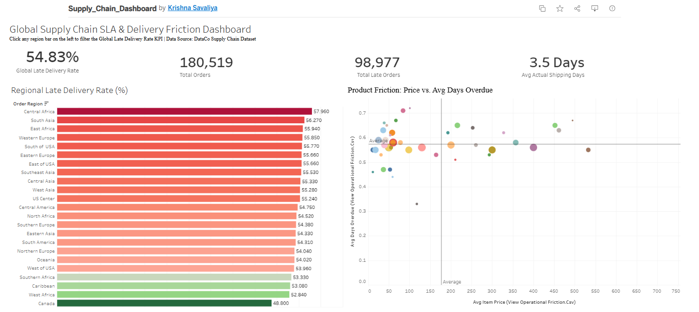

# 🚚 Supply Chain SLA & Friction Analytics

**Author:** Krishna Savaliya  
**Tech Stack:** PostgreSQL · SQL Views · Tableau

## 📌 Project Overview
This end-to-end data engineering and business intelligence project analyzes global order fulfillment data from the **DataCo Supply Chain Dataset** to uncover regional shipping bottlenecks and product-level delivery delays. 

Using **PostgreSQL**, raw flat-file logistics records were staged, cleaned, and modeled into analytical SQL views. These views feed an interactive **Tableau** dashboard designed to help supply chain teams monitor Service Level Agreement (SLA) compliance and prioritize operational fixes.

---

## 🏗️ Project Architecture & Workflow

1. **Raw CSV Staging (`staging_dataco`):** Imported all 53 raw columns from the DataCo dataset as `TEXT` fields to guarantee error-free bulk loading.
2. **Schema Standardization (`supply_chain_raw`):** Cast 7 core logistics columns into strict `INT`, `VARCHAR`, and `NUMERIC` data types for fast, reliable querying.
3. **Analytical SQL Views:** Engineered two reusable views (`view_regional_sla` and `view_product_friction`) to pre-aggregate regional late rates and category-level overdue variance.
4. **Executive Reporting (`Supply_Chain_Dashboard.twb`):** Built an interactive Tableau dashboard with cross-filtering across KPI cards, regional bar charts, and a product friction scatter plot.

---

## 🗄️ Database Schema & SQL Logic

### 1. Core Production Table (`supply_chain_raw`)

| Column Name | Data Type | Analytical Role |
| :--- | :--- | :--- |
| `order_id` | `INT NOT NULL` | Primary order volume & shipment count identifier |
| `days_for_shipping_real` | `INT` | Actual transit duration in days |
| `days_for_shipment_scheduled` | `INT` | Promised SLA transit duration in days |
| `delivery_status` | `VARCHAR(50)` | Fulfillment classification (e.g., Late delivery, Advance shipping) |
| `order_region` | `VARCHAR(100)` | Global geographic market grouping for regional SLA tracking |
| `category_name` | `VARCHAR(100)` | Product line classification for inventory friction analysis |
| `product_price` | `NUMERIC(10,2)` | Unit item price used to evaluate value-at-risk during delays |

### 2. Analytical SQL Views
```sql
-- View 1: Regional SLA Performance
CREATE OR REPLACE VIEW view_regional_sla AS
SELECT
    order_region,
    COUNT(order_id) AS total_orders,
    SUM(CASE WHEN delivery_status = 'Late delivery' THEN 1 ELSE 0 END) AS late_orders,
    ROUND((SUM(CASE WHEN delivery_status = 'Late delivery' THEN 1 ELSE 0 END)::NUMERIC / COUNT(order_id)) * 100, 2) AS late_delivery_rate_pct,
    ROUND(AVG(days_for_shipping_real), 1) AS avg_actual_shipping_days
FROM supply_chain_raw
GROUP BY order_region;

-- View 2: Inventory Operational Friction
CREATE OR REPLACE VIEW view_product_friction AS
SELECT
    category_name,
    COUNT(order_id) AS units_shipped,
    ROUND(AVG(product_price), 2) AS avg_item_price,
    ROUND(AVG(days_for_shipping_real - days_for_shipment_scheduled), 2) AS avg_days_overdue
FROM supply_chain_raw
GROUP BY category_name
HAVING COUNT(order_id) > 100;
```

---
## 📊 Key Findings & Dashboard Highlights



* **Global SLA Baseline:** Across **180,519 total orders**, **98,977 orders** arrived late—resulting in a **54.83% global late delivery rate** and an average transit time of **3.5 days**.
* **Top Regional Bottlenecks:** **Central Africa (57.96%)**, **South Asia (56.27%)**, and **East Africa (55.94%)** experience the highest delay rates, whereas **Canada (48.80%)** performs best.
* **High-Value Product Friction:** Several high-ticket product categories priced above the **≈ $175** average also exceed the **≈ 0.57 days** average overdue threshold, creating retention risk among high-value buyers.
* **Interactive Cross-Filtering:** Clicking any region bar dynamically updates all four top-level KPI cards (Late Delivery Rate, Total Orders, Total Late Orders, and Avg Actual Shipping Days).

---

## 💡 Data-Driven Business Recommendations

1. **Audit Top Bottleneck Regions:** Focus carrier reviews and regional warehouse routing on **Central Africa (57.96%)**, **South Asia (56.27%)**, and **East Africa (55.94%)**.
2. **Recalibrate Promised Delivery Windows:** Adjust customer-facing delivery estimates or pre-stage inventory in regional hubs to account for the **≈ 0.57-day** average overdue gap.
3. **Prioritize High-Value Shipments:** Fast-track fulfillment for high-priced product categories (**> ≈ $175**) experiencing multi-day delays to protect profit margins and customer satisfaction.
4. **Expand Schema with Shipping Mode & Customer Data:** Ingest shipping_mode (Standard vs. First Class) and customer_segment from staging_dataco to pinpoint whether specific transit tiers drive the 54.83% delay rate.

---

